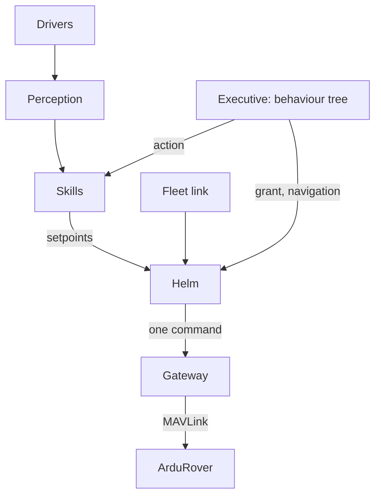

BlueBoat Core adds a backseat computer to a stock BlueBoat. The frontseat runs BlueOS and ArduRover and keeps control of stabilisation, manual driving and failsafes. The backseat runs ROS 2 Jazzy in Docker.

Every motion command takes one path:

## Vocabulary

| Term | Meaning |
| --- | --- |
| core | Runs on every vehicle: gateway, helm, executive, fleet link, recording. |
| module | One optional container. Its `kind` is driver, perception, skill or service. |
| application | Modules plus mission trees and parameters, such as a survey or a recovery mission. |
| payload | Physical hardware the boat carries. |
| mission | One start of the stack: one folder of data. |
| run | One plan executed by the executive. |
| trial | One repetition inside a run. |

## Layers

| Layer | Job | Fails how |
| --- | --- | --- |
| [Gateway](/architecture/gateway) | MAVLink bridge. Forwards only the helm's output, only in GUIDED, only under a fresh lease. | Silence revokes the lease. |
| [Helm](/architecture/helm) | Chooses the one command: grant, staleness, geofence, limits, collision avoidance. | The gateway stops forwarding. |
| [Executive](/architecture/executive) | Runs a plan as a behaviour tree and decides which skill may drive. | The helm holds position, then ends the engagement. |
| Modules | Sensors, perception, skills. | The executive sees a stale health report. |

## Authority, highest first

1. RC or ground station leaves GUIDED (ArduPilot)
2. Autopilot failsafes (ArduPilot)
3. Lease watchdog (gateway)
4. Collision avoidance, geofence, limits (helm)
5. The granted source (helm input)
